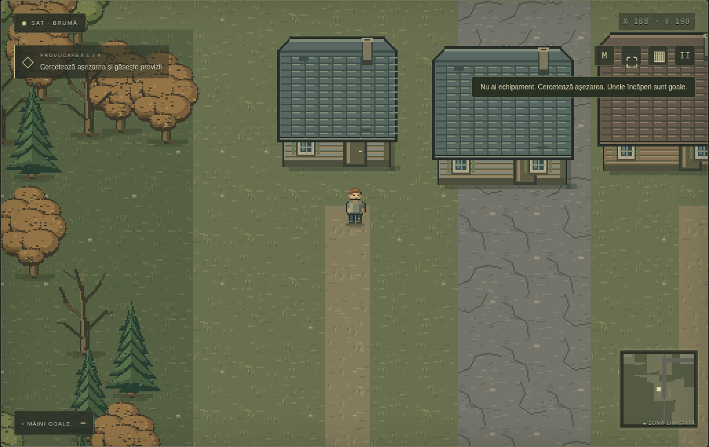
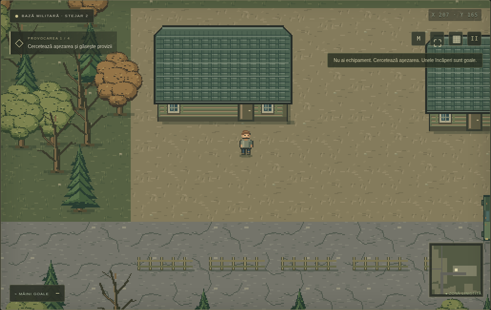

# Ultimul Răsărit · 0.3

A browser survival prototype for desktop and phones, with Romanian UI. Version 0.3 replaces the reference-image collage with a coherent original pixel-art renderer, real directional walking animation, generated settlements, ground-based building collisions, and sparse location-specific loot.

## Run

```sh
python3 -m http.server 8080 --bind 0.0.0.0
```

From the checkout, open the served site in a browser. `index.html`, `style.css`, `loot.js`, `world.js`, `art.js` and `game.js` are the entire running application. No packages, credentials, external images, databases or API calls are required. `assets/` preserves the user's old reference files for development, but they are not loaded by the game or included in the playable bundle.

## Play / download

```sh
python3 tools/bundle.py
```

The bundler produces `dist/Ultimul-Rasarit.html` and `dist/Ultimul-Rasarit-JOACA.zip`. The ZIP includes a self-contained `index.html` and Romanian instructions. Extract it fully, then open `index.html` with Chrome, Edge or Firefox. Chat's document preview can display source code instead of running a game; download the ZIP via the GitHub link rather than relying on workspace-file links.

No external art or Internet connection is required by the bundled version. Browser restrictions may affect local file storage. The game is a browser prototype, not an APK/iOS app.

## Graphics, animation and locations

- Integer-grid pixel art for 32px terrain, 12 original tree variations, original buildings, vehicles and props. No source-image crops, assembled screenshot panels or photographic textures.
- Survivor and nine zombie looks each have four directions, a stable idle and six authored walking frames. Movement advances animation only when an actor actually moves; idle and blocked actors stop stepping. The frame sprites change limbs and body pose, rather than stretching a static image.
- A 384 × 384 tile world with roughly 40–45 sites, depending on seed. Layouts vary: villages, stores, churchyards, military barracks, farms, warehouses, clinics, fuel stations, tents, workshops, lakes and roadblocks. Different seeds change building counts, sizes, styles, props, paths and storage. Building archetypes recur, but complete reference locations are not pasted or repeated as backdrops.
- Building physics uses only the ground footprint and a real doorway. The projected roof is visual and cannot block walking outside. Roofs fade when hiding someone behind them and disappear when inside; actual ground walls remain solid. Major props cannot overlap door approaches.

Screenshots of actual rendered gameplay:





## Loot and survival

Every new survivor starts with an empty bag, unloaded magazines and bare hands. There are 28 item types: guns, melee tools, different ammunition, food, bottled water, medical supplies, cloth, rope, matches, batteries, a flashlight and crafting resources. Consumables have differing effects. A flashlight needs a found battery and runs for a limited time.

E starts a short search of a nearby cabinet, locker, wreck or body. A search may find nothing. Results appear in a loot window; items enter the bag only after clicking an item or **Ridică tot**. Merely opening a container or killing an enemy never adds inventory. Corpses remain searchable; most are empty.

Each building has zero to three searchable containers, rather than four guaranteed items. Contents are rolled deterministically once during world generation and preserved when searching/saving; reloading does not reroll a container. Usually a successful search finds one item stack; two or three are unusual. Location profiles are defined in `loot.js`.

Selected probabilities **per ordinary manual container search** (not per building):

| Location | Empty | Pistol appears | Rifle appears |
| --- | ---: | ---: | ---: |
| Church | 72% | 0% | 0% |
| House | 76% | ~0.075% | 0% |
| Military | 57% | ~4.37% | ~3.40% |
| Store | 66% | 0% | 0% |
| Clinic | 63% | 0% | 0% |

Church profiles exclude **all weapons and ammunition**, including body searches. Specialized storage further restricts profiles: fridges contain food/water, toolboxes contain tools/resources, military lockers have somewhat better equipment chances. Weapon and ammunition discoveries remain separate; finding a gun does not load it.

Axes are needed for trees, pickaxes for rock deposits; loose branches/stones can be collected by hand. Craft bandages from cloth, tools from resources, and a healing campfire from wood/stone/matches. Hunger, thirst, stamina, day/night and zombie pursuit remain active.

## Controls

- WASD / arrows: move. Shift: run. Mouse: aim; left click or Space: attack.
- E: search, collect, or interact with a doorway. You can also walk through doorways.
- Loot window: click the chosen object, **Ridică tot**, or × to leave it behind.
- 1: cycle only weapons you own. R: reload a found gun from matching ammunition.
- 2 / 3 / 4: food / water / bandage. Bag items can be clicked to consume/equip.
- B / ▦: backpack; pauses the world while allowing inventory and crafting.
- M: map. Escape: close an overlay / pause. ⛶: fullscreen.
- Phones: joystick and attack/search buttons. Backpack, loot, map and vitals remain usable without scrolling away from gameplay.

## Saves

Autosave runs every 15 seconds, on pause, after manual pickup and when leaving the page. Storage is browser-local, without cross-device synchronization. Version 0.3 uses `ultimul-rasarit-v3`; the redesigned world and storage cannot load old 0.2 saves, which remain untouched. A new game is needed for the new version. Containers, extracted resources, searched bodies and placed fires persist. Live enemy population is rebuilt on loading.

## Validation

```sh
node --check art.js
node --check game.js
node --test tests/loot.test.cjs tests/world.test.cjs
node tests/browser-smoke.cjs
```

The browser suite uses the environment's Playwright and `/usr/bin/chromium`. On another machine supply Playwright and, if needed, `CHROMIUM_PATH`. `GAME_URL` overrides the default HTTP target (e.g. `GAME_URL=http://127.0.0.1:8082`). Tests cover statistical rarity/location exclusions, seeded persistence, varied layouts, clear doors, actual wall/roof geometry, pixel-frame differences, idle behavior, explicit search/pickup, combat without automatic rewards, body search/persistence, consumables, crafting, reload and mobile controls.
