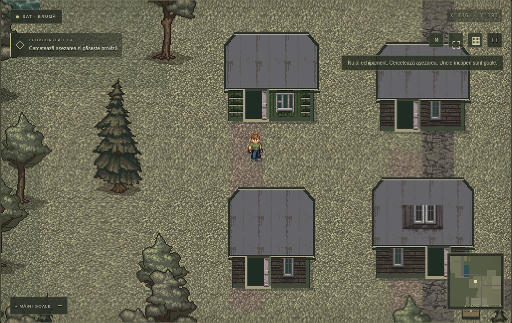
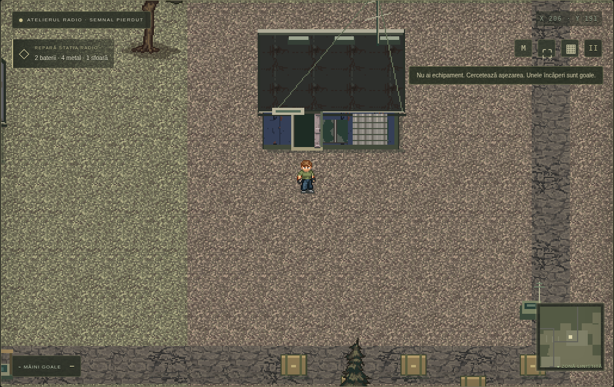

# Ultimul Răsărit · 0.4 — Semnal pierdut

A playable survival game for desktop and mobile browsers, with Romanian UI.
Version 0.4 uses the actual sprite assets from the user-selected
[011eh/minidayz](https://github.com/011eh/minidayz) reconstruction, at revision
`fa2e73a3f899bd59ded1a9e920eda92f822c32ba`, as the basis for our own generated
world, modular buildings and a radio-and-evacuation expedition.

## Download and play

Download `dist/Ultimul-Rasarit-JOACA.zip` from the versioned GitHub link, extract
it fully, and open `index.html` with Chrome, Edge or Firefox. The ZIP contains
one self-contained HTML game, Romanian instructions and asset credits.
Chat's document preview can show HTML source; use the ZIP download instead.
The portable game needs no Internet connection after downloading.

## What is new

- Genuine upstream survivor, T-shirt, jeans and nine infected models, using
  native 32×32 sprite cells and the four original walking frames per direction.
  Clothing and found weapons use their matching animation layers. No stretched
  limbs, guessed sprite cutouts or reconstructed reference-image characters.
- Actual ground tiles and living tree frames from the upstream atlases. A tree
  uses only its living half, with its trunk aligned to the collision point.
- New houses, radio workshops, field clinics and repair garages built from
  native roof, facade, window, door and floor elements. These have our own
  dimensions and layouts; complete location screenshots are not pasted into
  the map. Roof projection remains separate from solid ground walls.
- Three new authored locations near the initial region: the radio workshop,
  field medical point and evacuation jetty. Other settlements remain generated
  with varied buildings and props across a 384×384 tile world.
- **Semnal pierdut**: find the radio station R, collect two batteries, four scrap
  metal and one rope, and repair it explicitly. Stay within its area for a
  90-second transmission. Noise draws infected waves. Leaving the area or
  pausing the game stops progress. After confirmation, travel to the marked E
  jetty and interact to evacuate; you can continue exploring afterward.
- The world contains enough physically searchable repair components to make
  the expedition possible. Missing components are placed in suitable remote
  industrial storage, never in the player's inventory. No specific starter
  house or ordinary weapon is guaranteed.

Actual gameplay screenshots:





## Preserved survival rules

New survivors start with an empty bag, unloaded magazines and bare hands.
There are 28 useful item types, differing consumables, proper ammunition,
crafting tools, hunger/thirst, stamina, nightfall, a battery-powered flashlight,
manual searches, persistent containers and searchable infected bodies.

Houses have zero to three search spots, and most searches are empty. E starts
a timed search; the loot window requires you to click the chosen item or
**Ridică tot**. Killing an enemy or opening storage does not automatically
change inventory. Contents are deterministic and persist, so reloading does
not reroll them.

Ordinary manual-search profiles remain location-specific:

| Location | Empty | Pistol appears | Rifle appears |
| --- | ---: | ---: | ---: |
| Church | 72% | 0% | 0% |
| House | 76% | ~0.075% | 0% |
| Military | 57% | ~4.37% | ~3.40% |
| Store | 66% | 0% | 0% |
| Clinic | 63% | 0% | 0% |

Church profiles exclude every weapon and ammunition, including body searches.
The mission feasibility guarantee affects only missing battery/scrap/rope
supplies in suitable industrial storage, not these weapon probabilities.

## Controls

- WASD/arrows: move. Shift: run. Mouse: aim. Left click/Space: attack.
- E: search, collect, interact with a door, repair station or evacuation point.
- Walk through a real doorway to enter/exit a building; roofs are visual only.
- 1: cycle owned weapons. R: reload with matching ammunition.
- 2/3/4: food/water/bandage. Click bag items to equip or consume.
- B/▦: backpack. M: map with R (radio), E (jetty), + (clinic) markers.
- Escape: close an overlay/pause. ⛶: fullscreen. Phones use the touch controls.

Menus pause the simulation; the transmission advances only during active play
near the repaired radio. Saves use browser-local storage, without cross-device
synchronization. Version 0.4 uses a separate `ultimul-rasarit-v4` slot; begin a
new game for the new world. Older save slots are untouched. Searched storage,
corpses, collected resources, placed fires and expedition state persist; living
enemies are repopulated on load.

## Run and build

```sh
python3 -m http.server 8080 --bind 0.0.0.0
python3 tools/bundle.py
```

The source version serves local PNG files; the portable build embeds all 36
selected PNGs and all JavaScript. No packages, services, API keys or accounts
are required. This is a browser prototype, not an Android APK or iOS package.

To reproduce the unchanged asset import, check out the pinned upstream
revision separately, then run:

```sh
python3 tools/import_classic_assets.py /path/to/upstream-checkout
```

`assets/classic/manifest.json` records SHA-256 digests. The bundler verifies every
selected PNG before embedding it. Renderer `paths` lists determine what is
imported and packaged. See [THIRD_PARTY_ASSETS.md](THIRD_PARTY_ASSETS.md) for
provenance, original attribution and upstream license information; we do not
claim ownership of those sprites. The old user reference images are retained
for development only and are not loaded or packaged.

## Validation

```sh
node --test tests/loot.test.cjs tests/world.test.cjs tests/expedition.test.cjs
node tests/browser-smoke.cjs
```

The browser suite uses Playwright and the environment's `/usr/bin/chromium`.
Set `GAME_URL` for another server port and `CHROMIUM_PATH` if necessary.
Checks cover asset provenance/loading, real authored walking frames,
wall/roof/door physics, rare manual loot, no automatic kill rewards, saved
containers/corpses, consumables/crafting, mobile input, radio repair costs,
paused/distant transmission behavior, manual evacuation and saved completion.
